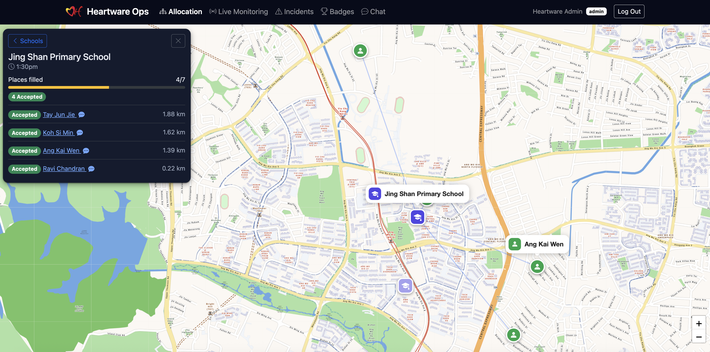
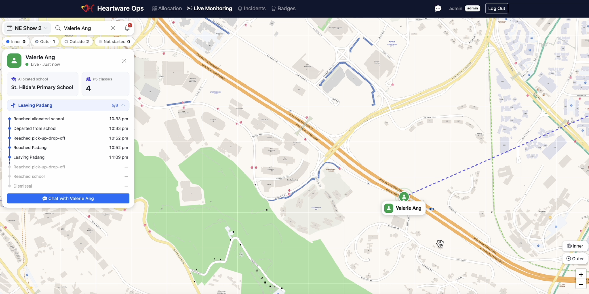
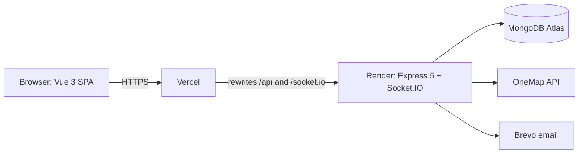

# Heartware Ops

**Volunteer allocation and live operations platform for the NDP show, built for Heartware.**

[]


[](LICENSE)

[**Live demo**](https://heartware-ops.vercel.app) · [Feature guide](docs/USAGE.md) · [Testing](docs/TESTING.md)



## The problem

Heartware runs the volunteer programme for the National Day Parade (NDP) show. Hundreds of volunteers need to be matched to primary schools, guided to the right place on show day, and supported when something goes wrong. Doing this by spreadsheet is slow, and it is hard to see what is happening once the day starts.

## The solution

Heartware Ops handles the whole journey. Volunteers register and say when they are free. The app **automatically assigns each volunteer to a nearby school**, the volunteer follows their route and checkpoints on show day, and the HQ team watches everything live and responds to incidents in real time.

## Key features

| Feature | What it does |
| --- | --- |
| **Smart Registration** | Email OTP stops fake sign-ups. Postal codes are verified with OneMap so addresses are accurate. |
| **Smart Allocation** | The ScarcityFirst algorithm matches volunteers to schools. Admins review a draft, then publish. |
| **Automated Assignment** | Volunteers accept, decline or withdraw. Directions via OneMap. A freed place goes to the nearest reserve. |
| **Live Tracking** | 8-checkpoint journey tracking, with an HQ live map and zone alerts. |
| **Incident Reporting** | Volunteers report incidents. HQ triages them on a queue and map and chats with volunteers in real time. |
| **Badges** | Badge studio, orders and automatic awards (Full Route, Early Bird, Super Sub). |



See the [feature guide](docs/USAGE.md) for how to use each one.

## Architecture



The client and API share one origin through Vercel rewrites, so the session cookie works without cross-site cookie workarounds.

## Technical highlights

- **ScarcityFirst allocation.** Instead of matching volunteers one by one, it finds the school that is hardest to staff (the one whose nearest free volunteers are furthest away), gives it its nearest volunteers, and repeats. This stops remote schools being left with leftovers. Distances use the haversine formula.
- **Reserve-list backfilling.** Volunteers who join after a show is published go on a reserve list, and open places are filled nearest-first, prioritising schools with the fewest reserves within 10 km.
- **Draft, then publish.** Allocation is a draft the admin can review and re-run safely (accepted volunteers keep their school) before volunteers can see it.
- **Real-time with secure sockets.** Socket.IO powers chat, incident alerts and badge updates. Connections reuse the login session, with a short-lived (60 second) JWT fallback from `/api/socket-token`.
- **Abuse protection.** Rate limiting on login, OTP and lookup endpoints. Location updates are limited to one every 5 seconds per volunteer.
- **Tested.** 9 server test files and client unit tests run in CI. 30 Playwright end-to-end tests cover every feature on both a desktop and an iPhone-sized viewport.

## Tech stack

- **Client:** Vue 3, Vite, Pinia, Vue Router, Bootstrap 5, Leaflet
- **Server:** Node 22, Express 5, Mongoose, Socket.IO, express-session
- **Data:** MongoDB Atlas, MOE schools dataset (data.gov.sg)
- **Services:** OneMap (geocoding, routing), Brevo (OTP emails)
- **Testing and CI:** Playwright, Vitest, Node test runner, oxlint, GitHub Actions
- **Hosting:** Vercel (client), Render (server)

## Quick start

Needs **Node 22.18+** and **pnpm** (`npm install -g pnpm`), plus a free [MongoDB Atlas](https://www.mongodb.com/atlas) cluster.

```bash
git clone https://github.com/YOUR_USERNAME/heartware-ops.git
cd heartware-ops

# Server
cd server && pnpm install
cp config.env.example config.env      # fill in DB, SECRET, ONEMAP_*; leave BREVO_API_KEY empty locally
pnpm run seed:shows && pnpm run seed:schools
ADMIN_EMAIL=you@example.com ADMIN_PASSWORD='choose-a-password' pnpm run seed:admin
pnpm run dev                          # http://localhost:8000

# Client (new terminal)
cd client && pnpm install && pnpm run dev   # http://localhost:5173
```

With `BREVO_API_KEY` empty, the 6-digit sign-up code is shown on the page instead of emailed. Add demo data with `pnpm run seed:volunteers`. If the server fails with a `bcrypt` error, run `pnpm approve-builds` and then `pnpm rebuild bcrypt` in `server/`. Full details: [feature guide](docs/USAGE.md), [testing guide](docs/TESTING.md).

## Try it

- **Volunteer side:** sign up on the [live site](https://heartware-ops.vercel.app) with a real email to receive the code. The server runs on a free tier, so the first load can take up to a minute to wake up.
- **Admin side:** admin tools can reset data, so access is not public. See the screenshots above and the [feature guide](docs/USAGE.md), or run the project locally with your own admin. Demo access is available on request.

## Team

Built by Group 5 Team 1. Each member owned one feature end to end.

| Member | Feature |
| --- | --- |
| Kuah Kuay Zen | Smart Registration |
| Fanny Lin | Smart Allocation |
| Yap Wei-Jian | Automated Assignment |
| Chin Jun Wen (ME) | Map Live Monitoring |
| Tan Wei Ming | Incident Reports |
| Hanafi Sani | Badge Studio |

## License

[MIT](LICENSE)
